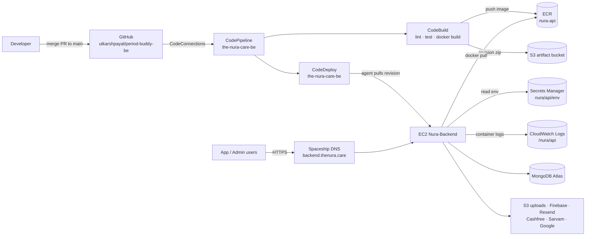

# Nura Backend — Infrastructure Guide

How the Nura API is built, deployed, configured and run in production, and
every service involved. Written for the whole team. You don't need to know
AWS to follow it. **Last verified against the live account: 2026-10-21.**

> **Quick facts**
> - API: `https://www.backend.thenura.care` (and `https://backend.thenura.care`)
> - AWS account `740726746628`, main region **ap-south-1 (Mumbai)**
> - Server: EC2 `Nura-Backend` (`i-0d127cfe92c1fbf76`), running Docker
> - Deploy: **merge to `main`** → pipeline `the-nura-care-be` builds, deploys and health-checks automatically
> - Secrets: AWS Secrets Manager `nura/api/env`. Never in git, never on the server's disk outside `/opt/nura/app.env`
> - Logs: CloudWatch log group `/nura/api`
> - Staging: `https://stage.backend.thenura.care`, a separate copy of all of this deployed from the `staging` branch ([§4.13](#413-staging))

---

## Contents

1. [The big picture](#1-the-big-picture)
2. [What happens on a deploy](#2-what-happens-on-a-deploy)
3. [How a request reaches the API](#3-how-a-request-reaches-the-api)
4. [AWS services, one by one](#4-aws-services-one-by-one)
5. [IAM roles and permissions](#5-iam-roles-and-permissions)
6. [The server](#6-the-server)
7. [Configuration and secrets](#7-configuration-and-secrets)
8. [Third-party services](#8-third-party-services)
9. [Files in this repo](#9-files-in-this-repo)
10. [Day-to-day runbook](#10-day-to-day-runbook)
11. [Troubleshooting](#11-troubleshooting)
12. [Change history](#12-change-history)
13. [Known risks and to-dos](#13-known-risks-and-to-dos)
14. [Costs](#14-costs)
15. [The CloudFormation alternative](#15-the-cloudformation-alternative)
16. [Glossary](#16-glossary)

---

## 1. The big picture



There is **one server** running **two Docker containers**:

| Container | Image | Job |
|---|---|---|
| `caddy` | `caddy:2.8-alpine` (Docker Hub) | Listens on ports 80/443. Gets and renews free HTTPS certificates from Let's Encrypt automatically. Forwards traffic (including WebSockets) to the API. |
| `api` | `…ecr…/nura-api:<git-sha>` (our image) | The Node.js/Express API on internal port 5000. |

**Why only one server?** WebSocket chat rooms and the reminder/check-in-call
scheduler live in the API process's memory. A second server would split chat
rooms and fire every reminder twice. To handle more load, use a **bigger**
instance, not more instances.

---

## 2. What happens on a deploy

Trigger: any push/merge to `main` (or **Release change** in the CodePipeline console).

| # | Stage | Service | What it does | Time |
|---|---|---|---|---|
| 1 | Source | CodePipeline + CodeConnections | Downloads the commit from GitHub as a zip | ~10 s |
| 2 | Build | CodeBuild (`buildspec.yml`) | Checks the 4 env vars are set → `npm ci` → `npm run lint` → `npm test` → `docker build` → pushes the image to ECR as `:<first 12 chars of commit>` and `:latest` → writes `deploy/release.env` (which image to run, secret name, log group, domains) | 3–5 min |
| 3 | Deploy | CodeDeploy → agent on EC2 | Copies `appspec.yml` + `deploy/` to `/opt/nura/release`, then runs the hooks below | 30–60 s |

CodeDeploy hooks (`appspec.yml`), all run as root on the server:

| Hook | Script | What it does |
|---|---|---|
| AfterInstall | `deploy/scripts/install.sh` | Logs in to ECR, **pulls the new image**, reads `nura/api/env` from Secrets Manager and writes it to `/opt/nura/app.env` (fails if `MONGODB_URI`/`JWT_SECRET` are empty), writes `/opt/nura/.env`, copies `docker-compose.yml` + `Caddyfile`, validates the compose config. **Nothing running is touched yet.** |
| ApplicationStart | `deploy/scripts/start.sh` | `docker compose up -d`: recreates the `api` container with the new image (a few seconds of downtime). Reloads Caddy. Deletes images no longer in use. |
| ValidateService | `deploy/scripts/validate.sh` | Calls `/health/ready` inside the container up to 30 × 4 s. Ready = MongoDB connected. If it never becomes ready, the deploy **fails**. |

**Automatic rollback:** the deployment group has auto-rollback on
`DEPLOYMENT_FAILURE`. A failed deploy redeploys the last good revision, which
pulls its old image back from ECR.

**A failed lint or test stops the pipeline at Build.** Nothing reaches the server.

---

## 3. How a request reaches the API

1. The app calls `https://www.backend.thenura.care/api/...`.
2. **Spaceship DNS** (`launch1/2.spaceship.net`) resolves `backend` and `www.backend` A records → `15.252.118.87` (the server's Elastic IP).
3. The **security group** `launch-wizard-5` allows TCP 80/443 in.
4. **Caddy** terminates TLS (Let's Encrypt certificate for both names) and adds `X-Forwarded-Proto`. HTTP → HTTPS redirect is automatic. Max request body 320 MB (reel uploads are up to 300 MB). Responses are gzip/zstd compressed.
5. Caddy proxies to `api:5000` over the private Docker network. WebSocket upgrades pass through unchanged.
6. Express trusts exactly **one** proxy hop (`app.set('trust proxy', 1)`), so rate limiting sees the real client IP.

Health endpoints:

| URL | Meaning |
|---|---|
| `/health` | Process is alive (never touches the DB). Used by Docker's `HEALTHCHECK`. |
| `/health/ready` | Alive **and** MongoDB connected. Used by the deploy's ValidateService. |

---

## 4. AWS services, one by one

All in **ap-south-1** unless stated otherwise.

### 4.1 CodeConnections (GitHub connection)
- **What:** Lets AWS read our GitHub repo without storing a GitHub token.
- **Ours:** `arn:aws:codeconnections:eu-west-2:740726746628:connection/92505a40-…`. Note: it lives in **eu-west-2 (London)**, because it was created there first. It works fine cross-region.
- **Watch out:** If someone revokes the AWS app in GitHub settings, the Source stage fails. Fix: Developer Tools → Settings → Connections → update pending connection.

### 4.2 CodePipeline
- **What:** The conveyor belt that runs Source → Build → Deploy on every push.
- **Ours:** `the-nura-care-be` (V2 pipeline, QUEUED mode, trigger: push to `main`).
- **Artifact store:** S3 bucket `codepipeline-ap-south-1-e5f6985dd25c-4099-9bcf-3dd630269338` (holds each run's source zip and build output).
- **Role:** `AWSCodePipelineServiceRole-ap-south-1-the-nura-care-be` (see §5).
- **Console:** CodePipeline → Pipelines → `the-nura-care-be`. **Retry** re-runs a failed stage; **Release change** runs from the latest commit.

### 4.3 CodeBuild
- **What:** A throwaway Linux machine that runs `buildspec.yml`.
- **Ours:** project `the-nura-care-be`, image `aws/codebuild/amazonlinux-x86_64-standard:6.0`, `BUILD_GENERAL1_MEDIUM`, **privileged mode on** (needed to run `docker build`).
- **Environment variables** (set on the project, not in git):

  | Name | Value |
  |---|---|
  | `ECR_REPOSITORY_URI` | `740726746628.dkr.ecr.ap-south-1.amazonaws.com/nura-api` |
  | `SECRET_ID` | `nura/api/env` |
  | `LOG_GROUP` | `/nura/api` |
  | `SITE_ADDRESS` | `backend.thenura.care,www.backend.thenura.care` (domains Caddy serves) |

- **Logs:** CloudWatch `/aws/codebuild/the-nura-care-be`, or click the build in the console.
- **Base image:** the Dockerfile pulls `node:20-bookworm-slim` from `public.ecr.aws/docker/library` (same official image as Docker Hub) to avoid Docker Hub's anonymous pull limits on CodeBuild's shared IPs.

### 4.4 ECR (Elastic Container Registry)
- **What:** Private Docker image storage.
- **Ours:** repository `nura-api` → `740726746628.dkr.ecr.ap-south-1.amazonaws.com/nura-api`.
- **Settings:** scan on push (vulnerability scan), lifecycle rule **keep the 20 newest images**.
- **Tags:** every build pushes `:<12-char commit sha>` and `:latest`. The server always runs the exact sha tag, never `latest`.
- (The other repo `cadence-backend-nest` belongs to a different project. Ignore it.)

### 4.5 CodeDeploy
- **What:** Runs our deploy scripts on the server, in order, and rolls back on failure.
- **Ours:** application `the-nura-care-be`, deployment group `the-nura-care-be`.
- **Target:** EC2 instances tagged **`Name = Nura-Backend`**. Renaming the instance breaks deploys.
- **Config:** `CodeDeployDefault.AllAtOnce`, auto-rollback on failure **enabled**.
- **Role:** `nura-backend-be-codedeploy-role` (AWS-managed `AWSCodeDeployRole`).
- **Agent:** `codedeploy-agent` systemd service on the server (v1.8.1). It polls AWS for work, so no inbound port is needed.

### 4.6 EC2 (the server)
- **Instance:** `Nura-Backend`, `i-0d127cfe92c1fbf76`, `t3.small` (2 vCPU, 2 GB RAM), ap-south-1b, default VPC.
- **OS:** Ubuntu 26.04 LTS.
- **Public IP:** Elastic IP `15.252.118.87` (`eipalloc-0cd7592f67916a9f9`), so it survives a stop/start.
- **Disk:** 20 GB gp3, tagged `Backup=nura-daily`: the DLM policy `policy-064f21f7c38309929` ("nura prod daily EBS snapshots") snapshots it every day at 21:30 UTC and keeps 7.
- **Alarms** (CloudWatch → SNS topic `nura-alerts`, email): `nura-prod-cpu-high`, `nura-prod-instance-check-failed` (also reboots the instance) and `nura-prod-system-check-failed` (also recovers it onto new hardware).
- **IMDSv2 required.** Hop limit 2, so the SDK inside the container can reach the instance role.
- **Instance profile:** `nura-backend-instance-role` (see §5).
- Details of what runs on it: [§6](#6-the-server).

### 4.7 Security group
- **Ours:** `launch-wizard-5` (`sg-0d9e2f4d400f71b21`).
- **Inbound:** 80 (HTTP, needed for Let's Encrypt and redirect), 443 (HTTPS), **22 (SSH, open to the world: close it, see risks)**.
- Outbound: all (to MongoDB Atlas, AWS APIs, third parties).

### 4.8 Secrets Manager
- **What:** Encrypted storage for the API's environment variables.
- **Ours:** secret `nura/api/env`: one JSON object `{"KEY": "value", ...}`, currently 41 keys.
- **Who reads it:** only the server's instance role, at deploy time (`install.sh`).
- **How to change:** see [§7](#7-configuration-and-secrets).

### 4.9 CloudWatch Logs
| Log group | Contents | Retention |
|---|---|---|
| `/nura/api` → stream `api` | API logs (winston JSON: `action`, `level`, `message`, …) | 30 days |
| `/nura/api` → stream `caddy` | Proxy/TLS logs (certificates, errors) | 30 days |
| `/aws/codebuild/the-nura-care-be` | Build output | default |

Docker ships container logs straight to CloudWatch (`awslogs` driver), so
`docker compose logs` on the server shows the same thing.

### 4.10 Systems Manager (SSM) Session Manager
- **What:** Browser/CLI shell on the server **without SSH**.
- **How:** EC2 → select instance → **Connect → Session Manager**, or
  `aws ssm start-session --target i-0d127cfe92c1fbf76 --region ap-south-1`.
- Enabled by `AmazonSSMManagedInstanceCore` on the instance role; the SSM agent is preinstalled (snap).

### 4.11 S3 (uploads)
- Bucket **`thenura`** in **us-east-1**. It holds user uploads (documents, media). The API uses it through `utils/s3.js`.
- A bucket policy makes only the public media prefixes readable by anyone (`users/`, `doctors/`, `content/`, `cms/`, `notifications/`, `company-assets/`, `uploads/`). `medical-documents/` is private and only reachable through short-lived signed links.
- **Versioning is off**, so a deleted or overwritten object can't be recovered (see risks).
- The instance role has read/write/delete on it (`nura_api_uploads`). The app currently also has static `AWS_ACCESS_KEY_ID`/`AWS_SECRET_ACCESS_KEY` in the secret, and those take priority if set.

### 4.12 EventBridge (legacy, us-east-1)
- Rule `nura-checkin-call-tick` is **ENABLED** and targets the old `/scheduler-tick` URL, but its API destination is inactive, so it currently does nothing.
- The in-process scheduler inside the API does this job now. **Disable/delete the rule** so it can't cause double check-in calls if the destination is ever re-activated.

### 4.13 Staging
A second, smaller copy of the backend for testing before release. Created from
[`infra/cloudformation/`](../infra/cloudformation/) as stack `nura-stage-api`.

| | Production | Staging |
|---|---|---|
| API | `https://www.backend.thenura.care` | `https://stage.backend.thenura.care` (`/health` reports `environment: staging`) |
| Deploys from | `main` → pipeline `the-nura-care-be` | `staging` → pipeline `nura-stage-api` |
| Server | `Nura-Backend` (`i-0d127cfe92c1fbf76`), Ubuntu | `nura-stage-api` (`i-0d7acfe48a9c7ab75`), Amazon Linux 2023, `t3.small` |
| Elastic IP | `15.252.118.87` | `13.205.94.59` |
| Secret | `nura/api/env` | `nura-stage/api/env` |
| Uploads bucket | `thenura` (us-east-1) | `nura-stage-uploads-740726746628` (ap-south-1) |
| Alarms | `nura-prod-*` | `nura-stage-*` (same SNS topic) |
| Disk snapshots | daily, 7 kept | none yet (tag its volume `Backup=nura-daily` to add it) |
| Frontends allowed (`ALLOWED_ORIGINS`) | `thenura.care` and every `*.thenura.care` subdomain (`www`, `admin`, `cms`, `app` = the web app / PWA) | every `*.thenura.care` subdomain |

Staging frontends: `https://staging.admin.thenura.care` and
`https://staging.cms.thenura.care` (Vercel, `staging` branch). The mobile
app's `preview`/`development` EAS builds use staging, `production` uses prod.

The staging secret must never reuse production's database, `JWT_SECRET` or
`DATA_ENCRYPTION_KEYS`, and should use `CASHFREE_ENV=sandbox`.

---

## 5. IAM roles and permissions

Policy JSON files are kept in [`infra/iam/`](../infra/iam/).

| Role | Used by | Permissions | Where defined |
|---|---|---|---|
| `codebuild-the-nura-care-be-service-role` | CodeBuild | AWS-made: build logs, artifacts, GitHub connection. **Ours:** inline `nura-ecr-push` = ECR login + push to `nura-api` only | [`iam/codebuild-inline-policy.json`](../infra/iam/codebuild-inline-policy.json) |
| `AWSCodePipelineServiceRole-ap-south-1-the-nura-care-be` | CodePipeline | AWS-made: S3 artifacts, CodeBuild, connection. **Ours:** inline `nura-codedeploy-release` = register revision + create deployment for this app only | [`iam/codepipeline-inline-policy.json`](../infra/iam/codepipeline-inline-policy.json) |
| `nura-backend-be-codedeploy-role` | CodeDeploy service | AWS-managed `AWSCodeDeployRole` (find instances by tag, run deployments) | AWS console |
| `nura-backend-instance-role` | The EC2 server (instance profile) | `AmazonSSMManagedInstanceCore` (Session Manager) · inline `nura_api_host` = ECR pull from `nura-api`, read secret `nura/api/env`, write logs to `/nura/api`, read deploy bundles from the artifact bucket · inline `nura_api_uploads` = read/write S3 bucket `thenura` | [`iam/instance-inline-policy.json`](../infra/iam/instance-inline-policy.json) |

Principles:
- Every policy is scoped to **our** resources (one ECR repo, one secret, one log group). The only exception is `ecr:GetAuthorizationToken`, which AWS only allows on `*`.
- The server can **read** its secret but not change it. Change secrets from a laptop.
- No AWS access keys are stored on the server. It uses the instance role.

---

## 6. The server

### 6.1 What's installed

| Software | Why |
|---|---|
| Docker Engine + Compose plugin (v5.x) | Runs the containers. Compose must be ≥ 2.30 (`env_file format: raw`). |
| AWS CLI v2 | Used by `install.sh` (ECR login, read secret). |
| `jq` | Used by `install.sh` to turn the secret JSON into `KEY=value` lines. |
| CodeDeploy agent 1.8.1 | Receives deployments. **Installed from a repacked .deb:** the official package only accepts Ruby ≤ 3.2, Ubuntu 26.04 ships Ruby 3.3 (see §11). |
| SSM agent (snap) | Session Manager shell. |

Set up by [`infra/scripts/bootstrap-host.sh`](../infra/scripts/bootstrap-host.sh) (safe to re-run).

**Old setup being removed** (check it's done: §13): nginx, certbot + `/etc/letsencrypt`, pm2 (`pm2-ubuntu` service), Node.js on the host, and `~/period-buddy-be` (old code checkout **with a plaintext `.env`**).

### 6.2 Files on the server

```
/opt/nura/
├── docker-compose.yml   ← copied from deploy/ on each deploy
├── Caddyfile            ← copied from deploy/ on each deploy
├── .env                 ← compose settings: IMAGE_URI, AWS_REGION, LOG_GROUP, SITE_ADDRESS
├── app.env              ← the API's environment, rendered from Secrets Manager (chmod 600)
├── docker-compose.override.yml   ← OPTIONAL host-only tweaks; never overwritten by deploys
└── release/             ← the latest CodeDeploy bundle (appspec.yml + deploy/)
```

Docker volumes: `nura_caddy_data` (**TLS certificates — don't delete**; recreating
too often hits Let's Encrypt rate limits) and `nura_caddy_config`.

### 6.3 Behaviour

- Both containers use `restart: unless-stopped`, so they come back after a reboot or crash.
- `api` stop grace period is 15 s. The API closes WebSockets, stops schedulers and disconnects Mongo on SIGTERM (via `tini`).
- Caddy starts only after `api` is healthy.
- The container runs as the non-root `node` user and has no secrets baked into the image (`.dockerignore` excludes `.env*`, service-account files, etc.).

---

## 7. Configuration and secrets

### 7.1 How a value gets into the API

```
.env file (your laptop, never committed)
   │  infra/scripts/push-env-to-secret.sh
   ▼
Secrets Manager: nura/api/env   (JSON)
   │  deploy → install.sh
   ▼
/opt/nura/app.env on the server
   │  docker compose env_file (raw: no quote/$ processing)
   ▼
process.env inside the api container
```

`NODE_ENV=production` and `PORT=5000` are set by `docker-compose.yml`, and any value in the secret for them is ignored.

### 7.2 Changing a value

```bash
# on your laptop, in the repo (needs npm install, jq, AWS CLI with your IAM user)
infra/scripts/push-env-to-secret.sh .env.production nura/api/env ap-south-1
```
Then CodePipeline → **Release change**. Values are only read at deploy time, so
editing the secret alone changes nothing until the next deploy.

Or edit directly: Secrets Manager → `nura/api/env` → Retrieve secret value → Edit.
Keep it a single valid JSON object.

### 7.3 Keys in the secret (names only)

| Group | Keys |
|---|---|
| Core | `MONGODB_URI`\*, `JWT_SECRET`\* (≥ 32 chars), `JWT_EXPIRE`, `BCRYPT_ROUNDS` |
| Security & privacy ([SECURITY.md](SECURITY.md)) | `DATA_ENCRYPTION_KEYS`\*\* (the server won't start in production without it; must be the key the data was encrypted with, never a new one), `AI_CONSENT_ENFORCED`, `STAFF_2FA_ENABLED`, `STAFF_COOKIE_AUTH`, `STAFF_SESSION_TTL`, `LOGIN_MAX_FAILURES`, `LOGIN_LOCK_MINUTES`, `ACCOUNT_PURGE_AFTER_DAYS`, `NOTIFICATION_RETENTION_DAYS`, `AUDIT_LOG_RETENTION_DAYS`, `USAGE_RETENTION_DAYS` |
| URLs / CORS | `API_BASE_URL` (`https://www.backend.thenura.care`: used for email links and the Sarvam webhook), `ALLOWED_ORIGINS` (prod: `https://thenura.care,https://*.thenura.care`; the pattern allows every https subdomain at any depth (`www`, `admin`, `cms`, `app`, the web app / PWA) but not the bare domain, hence the first entry; staging uses `https://*.thenura.care`; the mobile app sends no Origin and needs no entry), `ADMIN_APP_URL` |
| Email (Resend) | `RESEND_API_KEY`, `MAIL_FROM`, `CONTACT_RECEIVER_EMAIL` |
| Push (Firebase) | `FIREBASE_SERVICE_ACCOUNT_JSON` |
| Uploads (S3) | `AWS_S3_BUCKET` (`thenura`), `AWS_REGION` (`us-east-1`, the bucket's region), `AWS_ACCESS_KEY_ID`, `AWS_SECRET_ACCESS_KEY` |
| Google sign-in | `GOOGLE_WEB_CLIENT_ID`, `GOOGLE_IOS_CLIENT_ID`, `GOOGLE_ANDROID_CLIENT_ID`, `GOOGLE_EXPO_CLIENT_ID` |
| Payments (Cashfree) | `CASHFREE_APP_ID`, `CASHFREE_SECRET_KEY`, `CASHFREE_ENV` (`production`), `CASHFREE_AUTO_REFUNDS` (default on; `false` = refund cancellations by hand) |
| Doctor payouts (Cashfree Payouts, optional) | `CASHFREE_PAYOUT_CLIENT_ID`, `CASHFREE_PAYOUT_CLIENT_SECRET`, `CASHFREE_PAYOUT_PUBLIC_KEY`, `CASHFREE_PAYOUT_ENV`. Not set yet: withdrawals are paid manually by a Clinical Admin. |
| AI chat / speech (Sarvam) | `SARVAM_API_KEY`, `SARVAM_CHAT_MODEL`, `SARVAM_TTS_MODEL`, `SARVAM_TTS_SPEAKER`, `SARVAM_STT_MODEL` |
| Check-in phone calls (Sarvam Outbound) | `SARVAM_OUTBOUND_API_KEY`, `SARVAM_ORG_ID`, `SARVAM_WORKSPACE_ID`, `SARVAM_APP_ID`, `SARVAM_APP_VERSION`, `SARVAM_CONNECTION_ID`, `SARVAM_AGENT_PHONE_NUMBER`, `SAMVAAD_CALL_TOKEN_TTL` |
| Schedulers | `ENABLE_IN_PROCESS_SCHEDULER` (`true`, must stay on for this single-server setup), `CHECKIN_CALL_SCHEDULER_SECRET`, `NOTIFICATION_SCHEDULER_SECRET` |
| Video calls (Jitsi) | `JITSI_DOMAIN`, `JITSI_APP_ID`, `JITSI_APP_SECRET` (same as `JWT_APP_SECRET` on the Jitsi host), `JITSI_AUDIENCE`, `JITSI_TOKEN_TTL_SECONDS`, `CONSULTATION_JOIN_EARLY_MINUTES`, `CONSULTATION_JOIN_GRACE_MINUTES`, `CONSULTATION_DEFAULT_DURATION_MINUTES`, `VIDEO_JOIN_RATE_LIMIT_MAX`, `VIDEO_ATTENDANCE_RATE_LIMIT_MAX`, `VIDEO_JOIN_RATE_LIMIT_WINDOW_MS`. Not in the secret yet. |
| Misc | `SWAGGER_ENABLED` (`false`: `/api-docs` is closed in production) |

\* Required. The deploy fails on purpose if they're empty. \*\* Required in production; the API refuses to start without it. The full list with descriptions is in [`.env.example`](../.env.example).

**Adding a new env var:** add it to `.env.example` (for the team) **and** to the
secret (for production), then deploy. Adding it only to `.env.example` does nothing in production.

---

## 8. Third-party services

| Service | Used for | Where configured | Notes |
|---|---|---|---|
| **GitHub** `utkarshpayal/period-buddy-be` | Source code; `main` = production | CodeConnections | Merge to `main` deploys. |
| **Spaceship** | DNS for `thenura.care` | spaceship.com dashboard | A records `backend` + `www.backend` → `15.252.118.87` (prod) and `stage.backend` → `13.205.94.59` (staging). |
| **Let's Encrypt** | Free HTTPS certificates | Automatic via Caddy | Renewed automatically ~30 days before expiry. Needs port 80 open and DNS pointing here. |
| **MongoDB Atlas** | The database | `MONGODB_URI` | Atlas → Network Access must allow both server IPs, `15.252.118.87` (prod) and `13.205.94.59` (staging). Backups are Atlas's. |
| **Firebase (FCM)** project `the-nura-2b4a2` | Push notifications | `FIREBASE_SERVICE_ACCOUNT_JSON` | Android channel id must match the app (`default`). |
| **Resend** | All email: OTP, invites, newsletter, contact, suspension notices | `RESEND_API_KEY`, `MAIL_FROM` | `MAIL_FROM`'s domain must be verified in Resend. |
| **Cashfree** | Consultation + subscription payments | `CASHFREE_*` | Production mode. |
| **Cashfree Payouts** | Doctors' wallet withdrawals (optional) | `CASHFREE_PAYOUT_*` | Not activated yet. Needs: Payouts activated on the account, a funded Payouts balance, a 2FA public key (the server IP isn't an Elastic IP), and the webhook `https://www.backend.thenura.care/api/payouts/webhook/cashfree`. |
| **Sarvam AI** (`api.sarvam.ai`) | AI chat, speech-to-text, text-to-speech, document OCR | `SARVAM_API_KEY`, models | |
| **Sarvam Instant Outbound** (`apps.sarvam.ai`) | "Buddy" check-in phone calls | `SARVAM_OUTBOUND_*`, etc. | Calls back to `API_BASE_URL/.../checkin-call/webhook`, so the URL must be publicly reachable. |
| **Google Cloud (OAuth)** | "Sign in with Google" | `GOOGLE_*_CLIENT_ID` | |
| **AWS S3** bucket `thenura` | File uploads | `AWS_S3_*` | us-east-1. |
| **Jitsi Meet** (self-hosted, `meet.thenura.care`) | Every video call (consultations, Period Buddy) | `JITSI_*` | Its **own** host (Lightsail/EC2), never this server: [`infra/jitsi/README.md`](../infra/jitsi/README.md). Needs an A record `meet` → that host's static IP at Spaceship. Not deployed yet. |

---

## 9. Files in this repo

| File | Purpose |
|---|---|
| `Dockerfile` | Builds the API image: Node 20 slim, production deps only, non-root user, `tini`, `HEALTHCHECK` on `/health`. |
| `.dockerignore` | Keeps secrets, `node_modules`, tests, docs and deploy tooling out of the image. |
| `buildspec.yml` | CodeBuild steps (§2). |
| `appspec.yml` | CodeDeploy: where to copy the bundle and which hook scripts to run. |
| `deploy/docker-compose.yml` | The two containers, ports, logging, volumes. |
| `deploy/Caddyfile` | Reverse proxy + TLS config. |
| `deploy/scripts/common.sh` | Shared helpers for the hooks (paths, `compose` wrapper). |
| `deploy/scripts/install.sh` | AfterInstall hook: pull image, render secrets, stage config. |
| `deploy/scripts/start.sh` | ApplicationStart hook: swap containers, prune images. |
| `deploy/scripts/validate.sh` | ValidateService hook: wait for `/health/ready`. |
| `infra/scripts/bootstrap-host.sh` | One-time setup of a server (Docker, AWS CLI, CodeDeploy agent). |
| `infra/scripts/push-env-to-secret.sh` | Upload a `.env` file to Secrets Manager. |
| `infra/iam/*.json` | The inline IAM policies from §5. |
| `infra/cloudformation/backend.yml` | Alternative: creates the whole stack as code (§15). **Not what production runs today.** |
| `infra/README.md` | Setup guide for the CloudFormation route + console-pipeline notes. |
| `infra/jitsi/*` | The separate Jitsi video server: `install.sh`, `nura.env` (settings, no secrets), web config overrides and its runbook `README.md`. Runs on its own host, never this one. |
| `infra/cloudformation/jitsi.yml` | Optional EC2 host for Jitsi (own VPC, security group, Elastic IP, SSM). |
| `src/scripts/jitsiTokenCheck.js` | Prints test links proving the Jitsi server refuses bad tokens. |

---

## 10. Day-to-day runbook

**Deploy:** merge a PR to `main`. Watch CodePipeline → `the-nura-care-be`.

**Check health:**
```bash
curl https://www.backend.thenura.care/health/ready
```

**Logs:**
- Console: CloudWatch → Log groups → `/nura/api` → `api` / `caddy`.
- CLI: `aws logs tail /nura/api --follow --region ap-south-1`
- On the server: `cd /opt/nura && sudo docker compose logs -f api`

**Shell on the server:** EC2 → `Nura-Backend` → Connect → **Session Manager**.

**Status / restart on the server:**
```bash
cd /opt/nura
sudo docker compose ps            # api should be "healthy"
sudo docker compose restart api   # restart API only (keeps same image + env)
sudo docker compose up -d         # start everything if stopped
```
Never run `docker compose down` unless you mean to take the site offline.

**Roll back to an older version:** CodeDeploy → Applications → `the-nura-care-be`
→ Deployments → pick the last good one → **Redeploy**. Or revert the commit on `main`.

**Change an env var:** §7.2.

**Change the domains:** edit `SITE_ADDRESS` in the CodeBuild project's environment
variables, point DNS at the server, then Release change.

---

## 11. Troubleshooting

Problems we've already hit, and how they were fixed:

| Symptom | Cause | Fix |
|---|---|---|
| Build fails: `not authorized to perform: ecr:GetAuthorizationToken` | CodeBuild role had no ECR permissions; no ECR repo | Created `nura-api` repo + `nura-ecr-push` policy + env vars |
| Build fails: `CodeBuild env var X is not set` | Missing project env var | Add it in CodeBuild → project → Edit → Environment (§4.3) |
| Deploy fails: `CodeDeploy agent was not able to receive the lifecycle event` | Agent not installed/running, or no instance role | `bootstrap-host.sh`; `sudo systemctl restart codedeploy-agent` |
| Agent install: `Ruby version 2.x, 3.x needs to be installed` / `Depends: ruby2.0 … ruby3.2` | Ubuntu 26.04 has Ruby 3.3; AWS's package only lists ≤ 3.2 | Repack the .deb with `Depends: ruby` (done automatically by `bootstrap-host.sh`) |
| Deploy fails: `not authorized to perform: codedeploy:GetApplicationRevision` | Pipeline role missing permissions | Added `nura-codedeploy-release` policy |
| Deploy fails in AfterInstall: `Secret nura/api/env has no value for MONGODB_URI` | Secret empty | Fill it (§7.2) |
| Deploy fails in ValidateService | API can't reach Mongo (Atlas IP allow-list?) or crashes on boot | Check `docker compose logs api` / CloudWatch; failed deploy auto-rolls back |
| **502 Bad Gateway** from nginx | Old nginx was started again and forwards to port 5000, where nothing listens | `sudo systemctl disable --now nginx && cd /opt/nura && sudo docker compose up -d` |
| 502 from Caddy for a few seconds during deploy | API container being swapped | Normal. Clients retry. |
| Caddy log: certificate errors | DNS not pointing here, or port 80 blocked | Fix DNS/security group. Caddy retries by itself. |
| Deploy fails pulling image: `no space left on device` | Disk full | `sudo docker image prune -af`; grow the disk (§13) |

Useful commands on the server:
```bash
sudo systemctl status codedeploy-agent
sudo tail -100 /var/log/aws/codedeploy-agent/codedeploy-agent.log
sudo ss -ltnp | grep -E ':(80|443) '     # should show only docker-proxy
df -h /                                  # disk space
```

---

## 12. Change history

| When | What | Where |
|---|---|---|
| PR #12 | Docker image, compose + Caddy, CodeDeploy hooks, buildspec, CloudFormation template, setup guide | repo |
| PR #13 | Buildspec env-var guard; IAM policy files | repo |
| 2026-09-25 | Created ECR `nura-api`, secret `nura/api/env`, log group `/nura/api`; CodeBuild env vars + `nura-ecr-push`; enabled auto-rollback | AWS |
| PR #14 | `bootstrap-host.sh`; ECR Public base image; `.env.example` switched from SMTP to Resend | repo |
| PR #15 | Pipeline role policy file; added `nura-codedeploy-release` to the pipeline role | repo + AWS |
| 2026-09-25 | Created `nura-backend-instance-role` and attached it to `Nura-Backend`; filled the secret | AWS |
| PR #16, #17 | CodeDeploy agent install on Ruby 3.3 (repacked .deb) | repo |
| 2026-09-25 | **Cut over** from nginx + pm2 to Docker + Caddy on `Nura-Backend` | server |
| PR #18 | Prune all unused images after each deploy (disk space) | repo |
| 2026-09-30 | Secret: added `DATA_ENCRYPTION_KEYS` and the security/retention keys, removed unused `RAZORPAY_*` and `ADMIN_INVITE_CODE`; `SWAGGER_ENABLED=false`. Deployed with PR #43 (security & privacy) | AWS |
| by 2026-10-21 | Elastic IP `15.252.118.87` on `Nura-Backend`; disk grown to 20 GB; daily EBS snapshots (DLM); CloudWatch alarms with auto-reboot/recover → SNS `nura-alerts`; `ALLOWED_ORIGINS` narrowed to the Nura sites; spare Elastic IPs released | AWS |
| 2026-10-19 | Staging stack `nura-stage-api` (server, pipeline, secret, bucket, alarms) | AWS |
| 2026-10-21 | GitHub CI and security checks also run on `staging`; `npm audit fix` | repo |

---

## 13. Known risks and to-dos

| Priority | Item | Why it matters | Fix |
|---|---|---|---|
| 🟠 Medium | **SSH (22) open to 0.0.0.0/0** | Brute-force target; not needed (Session Manager works) | Remove the rule from `launch-wizard-5` |
| 🟠 Medium | **Production database reachable from laptops** | Local backends use the production `MONGODB_URI`, so a laptop can read production health data | Create a separate development database and user; keep the production URI only in the secret |
| 🟠 Medium | Old software still on server (nginx, certbot timer, pm2 service, Node, `~/period-buddy-be/.env` with plaintext secrets) | Confusion, and nginx could grab ports 80/443 again, causing 502s | Remove (check whether this has been done) |
| 🟠 Medium | **Root account still has access keys**; IAM users without MFA | Root keys can do anything, including closing the account | Delete the root access keys; turn on MFA for every IAM user; rotate old keys |
| 🟠 Medium | **Upload buckets have versioning off** | A deleted or overwritten medical document is gone for good | Turn on versioning with a lifecycle rule that expires old versions after 30 days |
| 🟠 Medium | **Jitsi host (Lightsail `nura-meeting`) has no snapshots or alarms** | Losing it means rebuilding the video server by hand | Enable Lightsail automatic snapshots; add a status-check alarm |
| 🟡 Low | No swap on a 2 GB server | Out-of-memory kill under load | Add a 2 GB swap file |
| 🟡 Low | EventBridge `nura-checkin-call-tick` still enabled (us-east-1) | Could double-fire check-in calls if re-activated | Disable/delete it |
| 🟡 Low | Staging disk has no snapshots | Staging data is lost if the disk fails | Tag its volume `Backup=nura-daily` |
| 🟡 Low | Static S3 keys in the secret | Long-lived keys; the instance role already has access | Remove `AWS_ACCESS_KEY_ID`/`AWS_SECRET_ACCESS_KEY` from the secret after testing uploads |
| 🟡 Low | `firebase-admin` 13 pulls in 7 moderate advisories (Firestore/Storage, which we don't use) | Only the `--audit-level=high` CI gate passes | Upgrade to `firebase-admin` 14, which needs Node 22: bump the Dockerfile, `buildspec.yml` and CI together |
| 🟡 Low | No uptime check | Alarms watch the instance, not the API | Add an uptime check on `/health/ready` |
| ℹ️ | Single server | By design (in-memory WebSockets/scheduler). Each deploy = a few seconds of downtime. | Scale up, not out |

---

## 14. Costs

Approximate, ap-south-1, per month:

| Item | ~ Cost |
|---|---|
| EC2 `t3.small` | $16 |
| EBS 20 GB gp3 + 7 daily snapshots | ~$2.5 |
| Elastic IP (attached) | $3.6 |
| CodePipeline V2 + CodeBuild minutes | $1–3 |
| ECR storage (≤ 20 images) | ~$0.5–1 |
| Secrets Manager (1 secret) | $0.4 |
| CloudWatch Logs | < $1 |
| **Total (production)** | **≈ $27** |

Staging roughly doubles the EC2, IP and pipeline lines (≈ $22 more).

MongoDB Atlas, Firebase, Resend, Cashfree, Sarvam and Spaceship are billed separately by those providers.

---

## 15. The CloudFormation alternative

[`infra/cloudformation/backend.yml`](../infra/cloudformation/backend.yml) creates an
equivalent setup **from scratch as code**: its own VPC, a new EC2 with an
Elastic IP, ECR `nura-api`, secret, logs, CodeBuild, CodeDeploy and a pipeline
named `nura-api`. It is **not deployed**. Production uses the hand-made
`the-nura-care-be` pipeline and the existing `Nura-Backend` server described above.

Use it to rebuild production cleanly (e.g. a new server with an Elastic IP and a
bigger disk, created reproducibly). Follow [`infra/README.md`](../infra/README.md). Before
you use it:
- It would create a **second** ECR repo/secret with the same names as the ones
  that exist now, and those names conflict. Delete or rename the manual ones first,
  or change `ProjectName`.
- Only one server may run the scheduler at a time. Stop the old one after switching DNS.

---

## 16. Glossary

| Term | Meaning |
|---|---|
| **Image** | A packaged, runnable snapshot of the API (code + Node + dependencies). Built once, run anywhere. |
| **Container** | A running instance of an image. |
| **ECR** | AWS's private registry where our images are stored. |
| **Revision / bundle** | The zip CodeDeploy copies to the server (`appspec.yml` + `deploy/`). It contains the *name* of the image to run, not the image itself. |
| **Hook** | A script CodeDeploy runs at a specific moment of the deploy. |
| **Instance role / profile** | AWS permissions given to the server itself, so no keys are stored on it. |
| **Inline policy** | A permission document attached directly to one role. |
| **Reverse proxy** | Caddy: receives public traffic and forwards it to the API. |
| **Let's Encrypt** | Free certificate authority that makes HTTPS work. |
| **Elastic IP** | A fixed public IP that stays the same across stop/start. |
| **Session Manager** | Shell access to the server through AWS, without SSH. |
